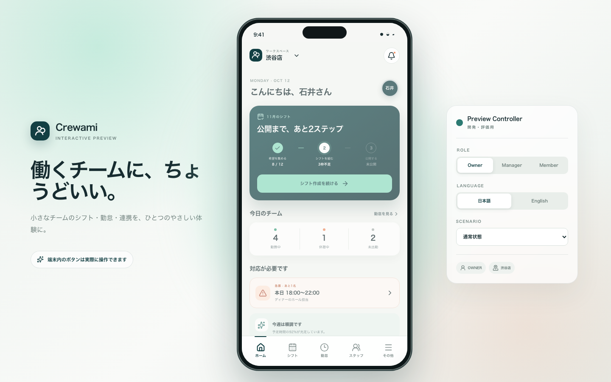

# Crewami UI Prototype

Crewami の完成後の操作感を、人が実際に触って評価するためのスマートフォン風インタラクティブ UI モックです。

公開URL: [https://kaito-ishii159.github.io/Crewami-mock/](https://kaito-ishii159.github.io/Crewami-mock/)

> [!IMPORTANT]
> 本番 Crewami とは分離された UX 検証用リポジトリです。バックエンド、DB、本物の認証・位置情報・通知・決済は接続せず、データと状態変更は React の local state にだけ保持します。ページを再読み込みすると初期状態へ戻ります。



## 起動と確認

Node.js 20.9 以上を使用します。

```bash
npm install
npm run dev
```

[http://localhost:3000](http://localhost:3000) を開いてください。提出前の確認コマンドは次のとおりです。

モックログインは `admin@example.com`（ADMIN）または `member@example.com`（MEMBER）、パスワードは `crewami-demo` です。入力内容の照合は行わず、メールアドレスでロールを切り替えます。

```bash
npm run lint
npm run typecheck
npm run build
npm run start
```

## Preview Controller

デスクトップ表示ではスマートフォン枠の右側に開発・評価専用コントローラーが表示されます。本番 UI の一部ではありません。

- `Role`: ADMIN / MEMBER
- `Language`: 日本語 / English
- `Scenario`: 通常、希望収集中、シフト作成中、勤務中、欠員あり、無料体験中、無料体験終了、シフト収集プラン、全機能プラン
- `Active users`: 87 / 128 / 247 人（100人単位料金の境界確認）

スマートフォン幅では phone frame と Preview Controller が消え、390 × 844 を含む通常の全画面アプリ表示になります。

## 最初に確認する5画面

1. `ログイン`: ADMIN / MEMBER のモックアカウント、パスワード再設定、招待メールからの初回パスワード設定を確認できます。
2. `ADMIN → その他 → 利用する機能`: 6機能のON/OFF、プラン制約、勤怠管理と給与概算の依存関係、ナビゲーションへの即時反映を確認できます。
3. `ADMIN → その他 → プランとお支払い`: 無料体験、期限切れ、2プラン、100人単位の料金計算、モック購入を確認できます。
4. `ADMIN → ホーム → シフト収集`: 月単位の希望入力、曜日一括設定、前週コピー、リマインド、CSV / Excel出力、専用シフト表連携の見積もり導線を確認できます。
5. `ADMIN → 勤怠 → スタッフ → 日付`: 出退勤・休憩の編集、修正理由、監査履歴、時給変更が反映される給与概算を確認できます。

## 実装済みの操作

### 管理者（ADMIN）

- メールアドレスとパスワードによるモックログイン、パスワード再設定、ログアウト
- 6機能の利用設定とプラン権限を合成したホーム・ナビゲーション・設定メニュー
- 希望収集の作成、月単位入力、曜日一括設定、前週コピー、進捗確認、未提出者への個別・一括通知
- シフト希望のCSV / Excelダウンロード、現在のExcel / CSVを添付する専用連携依頼、個別見積もり・承認・モック支払い
- 24時間ガント型シフト作成、4日切替、30分補助目盛り、勤務希望と確定シフトの重ね表示
- スタッフ行からの開始・終了時刻編集、確定・確定解除、状態別並び替え、公開確認と通知
- スタッフの検索、招待中 / 利用中 / 無効フィルター、メール招待、再送、編集、無効化、時給設定
- 今日の勤怠、履歴、出退勤・休憩編集、修正理由と監査履歴、給与概算
- 欠員募集と通知
- GPS共有マップ、店舗追加・編集・切替
- シフト収集プラン（¥500 / 100人 / 月）と全機能プラン（¥4,980 / 100人 / 月）、無料体験・期限切れ状態
- 共用端末でのスタッフ選択と出勤・休憩・退勤
- 通知センター、言語変更、フィードバック

### メンバー（MEMBER）

- メールアドレスとパスワードによるモックログイン、招待時の初回パスワード設定
- 勤務希望の入力、提出、確認・変更、一括入力と曜日コピー
- マイシフトと勤務詳細
- 出勤、休憩開始・終了、退勤
- 勤怠履歴、詳細、給与概算
- 募集中シフトへの応募・取消
- 勤務中のGPS共有ON/OFF
- 通知センター、言語変更、フィードバック

## プランと機能

無料体験中は全機能を利用できます。無料体験終了後は管理者にプラン選択を案内し、メンバーには管理者への確認を案内します。

| 機能 | シフト収集プラン | 全機能プラン |
| --- | --- | --- |
| シフト収集、CSV / Excel出力、専用連携依頼 | ✓ | ✓ |
| シフト管理、勤怠管理、緊急募集、GPS、給与概算 | — | ✓ |

月額は `ceil(利用中ユーザー数 / 100) × プラン単価` です。たとえば128人の場合、シフト収集プランは月額¥1,000、全機能プランは月額¥9,960になります。表示金額と購入・個別見積もりはすべてUX確認用のモックです。

## 表示ルール

- 権限は `ADMIN` と `MEMBER` の2種類です。
- ユーザー向け文言は日本語・英語を切り替えられます。
- シフト表は1時間ごとの主目盛りと30分ごとの補助目盛りを持ちます。
- 薄緑のストライプが勤務希望、濃緑が確定シフトです。
- 状態は `CONFIRMED` / `UNCONFIRMED` / `NO_AVAILABILITY` として管理し、色だけでなくラベルも表示します。
- 金額・プラン・位置情報・通知結果はUI確認用のサンプルです。
- スタッフは `INVITED` / `ACTIVE` / `DISABLED` の状態を持ち、招待はメールの初期パスワード設定へつながります。
- `給与概算` は `勤怠管理` に依存します。勤怠管理をOFFにすると給与概算もOFFになります。

## 技術構成

- Next.js 16 App Router
- React 19
- TypeScript strict mode
- Lucide React
- CSS custom properties / responsive layout

## スクリーンショット

- [Desktop preview](docs/screenshots/owner-home-desktop.png)
- [Mobile 390 × 844](docs/screenshots/owner-home-mobile.png)
