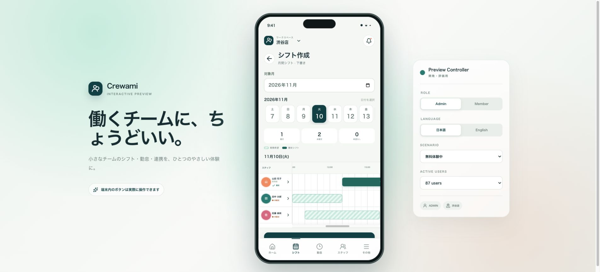

# Crewami UI Prototype

Crewami の完成後の操作感を、人が実際に触って評価するためのスマートフォン風インタラクティブ UI モックです。

公開URL: [https://kaito-ishii159.github.io/Crewami-mock/](https://kaito-ishii159.github.io/Crewami-mock/)

> [!IMPORTANT]
> 本番 Crewami とは分離された UX 検証用リポジトリです。バックエンド、DB、本物の認証・位置情報・通知・決済は接続せず、データと状態変更は React の local state にだけ保持します。ページを再読み込みすると初期状態へ戻ります。



## 起動と確認

Node.js 20.9 以上を使用します。

```bash
npm install
npm run dev
```

[http://localhost:3000](http://localhost:3000) を開いてください。提出前の確認コマンドは次のとおりです。

ログインは **店舗ID → メールアドレス → パスワード** の順に入力します。店舗IDとメールの組み合わせでアカウントを選び、local stateのモックパスワードを照合します。

| 店舗ID | メールアドレス | 権限 / スタッフ |
| --- | --- | --- |
| `SHIBUYA01` | `admin@example.com` | ADMIN / 山田 花子 |
| `SHIBUYA01` | `member@example.com` | MEMBER / 田中 太郎 |
| `SHINJUKU01` | `member@example.com` | MEMBER / 田中 太郎（別アカウント） |

上記の初期パスワードは `crewami-demo`。池袋店の店舗IDは `IKEBUKURO01` です。同一メールは別店舗にも登録でき、内部スタッフIDで希望・提出・アカウント状態を区別します。同一店舗内の重複メールはスタッフ追加時に検出します。

パスワード再設定にも店舗IDが必須です。招待メールからの初回設定では店舗と本人を表示し、店舗IDの再入力は不要です。追加した招待中スタッフの詳細から「招待メールの初回設定を確認」を操作できます。設定したパスワードで、その店舗のアカウントへログインできます。

```bash
npm run lint
npm run typecheck
npm test
npm run build
npm run start
```

## Preview Controller

デスクトップ表示ではスマートフォン枠の右側に開発・評価専用コントローラーが表示されます。本番 UI の一部ではありません。

- `Role`: ADMIN / MEMBER
- `Language`: 日本語 / English
- `Scenario`: 通常、希望収集中、シフト作成中、勤務中、欠員あり、無料体験中、無料体験終了、シフト収集プラン、全機能プラン
- `Active users`: 87 / 128 / 247 人（100人単位料金の境界確認）

スマートフォン幅では phone frame と Preview Controller が消え、390 × 844 を含む通常の全画面アプリ表示になります。

## 最初に確認する5画面

1. `ログイン`: ADMIN / MEMBER のモックアカウント、パスワード再設定、招待メールからの初回パスワード設定を確認できます。
2. `ADMIN → その他 → 利用する機能`: 6機能のON/OFF、プラン制約、勤怠管理と給与概算の依存関係、ナビゲーションへの即時反映を確認できます。
3. `ADMIN → その他 → プランとお支払い`: 無料体験、期限切れ、2プラン、100人単位の料金計算、モック購入を確認できます。
4. `ADMIN / MEMBER → 自分の希望を入力`: 月間カレンダーの日付をタップし、1日に複数の時間帯を保存して月全体を提出できます。
5. `ADMIN → 勤怠 → スタッフ → 日付`: 出退勤・休憩の編集、修正理由、監査履歴、時給変更が反映される給与概算を確認できます。

## 実装済みの操作

### 管理者（ADMIN）

- 店舗ID・メールアドレス・パスワードによるモックログイン、パスワード再設定、ログアウト
- 6機能の利用設定とプラン権限を合成したホーム・ナビゲーション・設定メニュー
- 希望収集の作成、カレンダー入力、日別複数時間帯、進捗確認、未提出者への個別・一括通知
- シフト希望のCSV / Excelダウンロード、現在のExcel / CSVを添付する専用連携依頼、個別見積もり・承認・モック支払い
- 月選択・1日〜月末ナビゲーション、24時間ガント型シフト作成、30分補助目盛り、複数の勤務希望と確定シフトの重ね表示
- スタッフ行からの開始・終了時刻編集、希望時間帯からの選択、確定・確定解除、状態別並び替え、公開確認と通知
- スタッフの検索、招待中 / 利用中 / 無効フィルター、メール招待、再送、編集、無効化、時給設定
- 今日の勤怠、履歴、出退勤・休憩編集、修正理由と監査履歴、給与概算
- 欠員募集と通知
- GPS共有マップ、店舗追加・編集・切替
- シフト収集プラン（¥500 / 100人 / 月）と全機能プラン（¥4,980 / 100人 / 月）、無料体験・期限切れ状態
- 共用端末でのスタッフ選択と出勤・休憩・退勤
- 通知センター、言語変更、フィードバック

### メンバー（MEMBER）

- 店舗ID・メールアドレス・パスワードによるモックログイン、招待時の初回パスワード設定
- 月間カレンダーによる勤務希望の入力、日別複数時間帯の追加・削除・編集、勤務不可、提出・再提出
- マイシフトと勤務詳細
- 出勤、休憩開始・終了、退勤
- 勤怠履歴、詳細、給与概算
- 募集中シフトへの応募・取消
- 勤務中のGPS共有ON/OFF
- 通知センター、言語変更、フィードバック

## 新しい管理表・カレンダー・月間シフト

- ログイン画面の「新しくシフト管理表を作成」から、管理者・店長向けの注意画面を経て新規作成します。招待済みスタッフには店舗IDでログインするよう明示しています。
- 店舗名、管理者名、メール、パスワードと確認を入力すると、重複しない `CRW-XXXXX` 形式の店舗IDを発行します。コピー、管理画面への移動、管理者のスタッフ登録、1か月無料体験を操作できます。
- カレンダーは7列で月全体を表示し、前月・翌月へ移動できます。日付を押すとbottom sheetが開き、時間帯を追加・削除して保存します。開始が終了以上、24時間範囲外、時間帯同士の重複を検出します。終了 `24:00` も指定できます。
- 保存はスタッフID・日付ごとの下書き。月全体を提出した時点のスナップショットを、提出状況・タイムライン・Exportへ反映します。再ログインや画面移動でもページを再読み込みしない限り保持します。
- ADMINの山田花子も通常のスタッフです。「自分のシフト希望」で提出し、同じ提出一覧・タイムラインに含まれます。
- 管理者の月選択から1日〜月末の日付を自動生成します。30日・31日・2月28/29日を扱い、選択日と確定編集は画面移動後も保持します。スタッフ名固定、右側0〜24時横スクロール、確定→未確定→希望なし順を維持します。一括割当・前週コピーはありません。
- CSV / Excel互換XML（`.xls`）は、提出された1時間帯を1行で出力します。勤務不可も出力し、全機能プランでは確定シフトを含めるチェックボックスを利用できます。Export内容のエスケープを行い、新しい実行時依存は追加していません。

## プランと機能

無料体験中は全機能を利用できます。無料体験終了後は管理者にプラン選択を案内し、メンバーには管理者への確認を案内します。

| 機能 | シフト収集プラン | 全機能プラン |
| --- | --- | --- |
| シフト収集、CSV / Excel出力、専用連携依頼 | ✓ | ✓ |
| シフト管理、勤怠管理、緊急募集、GPS、給与概算 | — | ✓ |

月額は `ceil(利用中ユーザー数 / 100) × プラン単価` です。たとえば128人の場合、シフト収集プランは月額¥1,000、全機能プランは月額¥9,960になります。表示金額と購入・個別見積もりはすべてUX確認用のモックです。

## 表示ルール

- 権限は `ADMIN` と `MEMBER` の2種類です。
- ユーザー向け文言は日本語・英語を切り替えられます。
- シフト表は1時間ごとの主目盛りと30分ごとの補助目盛りを持ちます。
- 薄緑のストライプが勤務希望、濃緑が確定シフトです。
- 状態は `CONFIRMED` / `UNCONFIRMED` / `NO_AVAILABILITY` として管理し、色だけでなくラベルも表示します。
- 金額・プラン・位置情報・通知結果はUI確認用のサンプルです。
- スタッフは `INVITED` / `ACTIVE` / `DISABLED` の状態を持ち、招待はメールの初期パスワード設定へつながります。
- `給与概算` は `勤怠管理` に依存します。勤怠管理をOFFにすると給与概算もOFFになります。

## 技術構成

- Next.js 16 App Router
- React 19
- TypeScript strict mode
- Lucide React
- CSS custom properties / responsive layout

## スクリーンショット

- [月間シフト作成 Desktop](docs/screenshots/monthly-builder-desktop.jpg)
- [月間シフト作成 390 × 844](docs/screenshots/monthly-builder-mobile.jpg)
- [メンバーカレンダー 390 × 844](docs/screenshots/availability-calendar-mobile.jpg)
- [日別複数時間帯 Editor](docs/screenshots/availability-editor-mobile.jpg)
- [店舗IDログイン](docs/screenshots/store-login-mobile.jpg)
- [新規管理表の注意画面](docs/screenshots/workspace-warning-mobile.jpg)
- [店舗ID発行完了](docs/screenshots/workspace-complete-mobile.jpg)

## 検証

`npm test` は月末・うるう年、時間帯の逆転・重複・24時、店舗別同一メール、管理者とメンバーの提出・タイムライン・Export、機能制約を検証します。CIでも実行します。

ChromeのDesktop / 390 × 844で、3つのデモログイン、日別2時間帯の保存・再編集・勤務不可・月提出、管理者自身の提出、12月31日と2028年2月29日、プラン・Feature切替、新規管理表の店舗ID発行とコピー、招待設定、既存業務機能を確認しています。CSV / Excelの実ファイルをダウンロードし、複数時間帯が別行に出ることも確認済みです。ブラウザconsoleのwarning / errorは0件でした。
